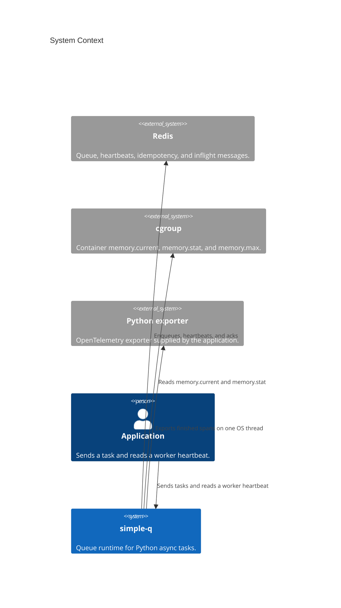

# Architecture

These pages describe simple-q 1.0.

The containers inside simple-q are **Client**, **App**, **Config**, the **worker supervisor**, and **Redis**. Client sends. App runs the handler and the dead-letter hook. `Config.from_env` reads only `SIMPLE_Q_*`. The worker uses the Redis URL stored on the `App`'s `Client`. `agent-worker enqueue` and `agent-worker admin` read `REDIS_URL` themselves. `HOSTNAME`, `BOARD_*`, `QUEUE`, `RUST_LOG`, and `DRAMATIQ_PROM_*` are read by the worker name, the board, the log filter, and the metrics process. The worker supervisor forks children and watches memory. Redis holds the queue.

This is the context diagram for that model.

## Call chains

These are the paths the code actually takes. Each chain stops at a Redis command or at the Python handler.

### Send and a delayed retry

`Client.send` and `Client.send_with_options` both call `prepare`, then `enqueue_prepared`, then `enqueue_job`. `prepare` runs `on_send` on the caller's task and builds a job with `retries = 0`. A first send with `unique_key` goes through `enqueue_unique`: apalis `SETNX`s `{queue}:idempotency:{key}` and sets its TTL to `SIMPLE_Q_UNIQUE_TTL_SECS`. A held key returns `None` from `send_with_options`. `send` raises in that case.

A retry does not start at `send`. After `App.dispatch` returns `retry`, `handle_job` adds one to `retries` and calls `enqueue_job` with the delay. `extend_idempotency_for_delay` then `EXPIRE`s the same key for the wait plus `unique_ttl`. The retry does not claim the key again.

### One delivery

The apalis worker calls `handle`, which calls `handle_job`. `incr_delivery` runs `INCR` and `EXPIRE` on `delivery:{message_id}:{retries}` before Python. `decide` returns `Run` when that count is at or below `max_deliveries`. `bridge.execute` calls `App.dispatch`. The handler is `declared.function` under `asyncio.wait_for`. Success deletes the delivery key and the idempotency key. A failure before the last attempt returns `retry` and keeps the idempotency key. The last failure calls `on_dead` and leaves the delivery key.

### Poison, before the handler

`decide` returns `Poison` when the `INCR` result is greater than `max_deliveries`. The count that equals the limit still runs. `handle_job` calls `App.note_dead` with reason `poison` and `error` unset. It does not call `dispatch`. The idempotency key is deleted. The delivery key stays, so the next start of that attempt is still poison.

`on_dead` receives one `DeadLetter`. `error` is `"{Type}: {message}"` only for `retries` and `timeout`.

### Worker heartbeat

`Client.worker_alive` uses the connection opened by a previous send. A client that has never connected returns `False` and does not call Redis. Otherwise the runtime parses `agent-worker.{queue}.{host}.{pid}.{suffix}`, reads `ZSCORE {queue}:workers`, and compares the score with Redis `TIME` against `heartbeat_secs * missed_heartbeats`.

### In-memory drain

`MemoryClient.drain` pops queued messages and calls `App.dispatch`. A `retry` outcome leaves the `unique_key` held and does not put the message back. Any other outcome, and a raised handler, release the key.

### Memory pressure

Once a second the supervisor reads each child's RSS and, when `memory.max` is finite, the cgroup working set (`memory.current` minus `inactive_file`). A per-child byte limit drains with `SIGUSR1` or kills with `SIGKILL`. A ratio `Kill` signals the largest child only when that child's RSS is at least half the usage. Otherwise the largest not-yet-drained child gets `SIGUSR1`. The child treats `SIGUSR1` as stop-taking-work. `SIGKILL` has no handler.

### Tracing

`tracing=None` installs no OpenTelemetry layer. Otherwise `PythonBatchProcessor.on_end` queues the finished span, and the OS thread `otel-export` calls `exporter.export`. Tokio tasks do not call into Python. Exit 2 skips the flush.
