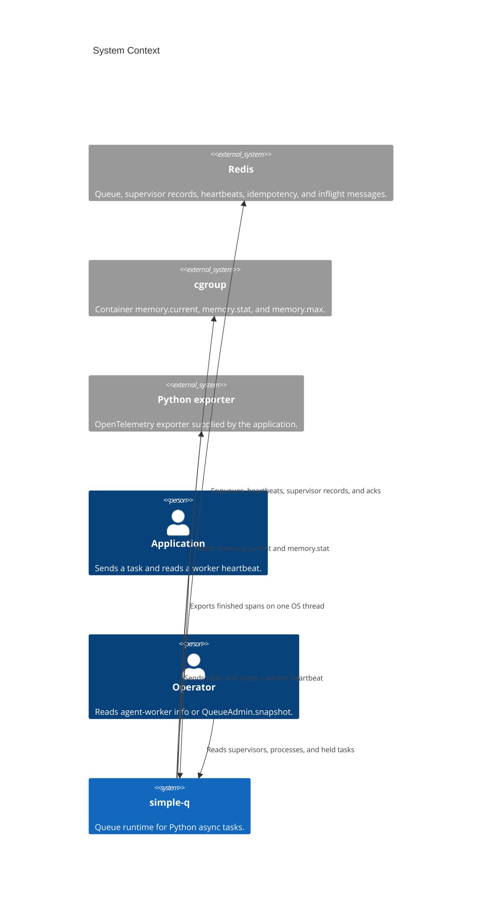

# Architecture

These pages describe simple-q 1.0.

The containers inside simple-q are **Client**, **App**, **Config**, the **worker supervisor**, and **Redis**. Client sends. App runs the handler and the dead-letter hook. `Config.from_env` reads only `SIMPLE_Q_*`. The worker uses the Redis URL stored on the `App`'s `Client`. `agent-worker enqueue` and `agent-worker admin` read `REDIS_URL` themselves. `agent-worker info` uses the same client URL as `worker`. `SIMPLE_Q_APP` and `SIMPLE_Q_APP_FACTORY` are read by `worker` and `info`, not by `Config.from_env`. The factory variable enables a call only for `1`, `true`, `yes`, or `on`. In a virtualenv the `agent-worker` command is a launcher that execs `agent-worker.bin` after the dynamic linker can see `libpython3.12.so.1.0`. `HOSTNAME`, `BOARD_*`, `QUEUE`, `RUST_LOG`, and `DRAMATIQ_PROM_*` are read by the worker name, the board, the log filter, and the metrics process. The worker supervisor forks children, watches memory, and publishes its own Redis record. It does not take messages and it does not heartbeat as a queue worker. Redis holds the queue and that supervisor record.

This is the context diagram for that model.

## Call chains

These are the paths the code actually takes. Each chain stops at a Redis command or at the Python handler.

### Send and a delayed retry

`Client.send` and `Client.send_with_options` both call `prepare`, then `enqueue_prepared`, then `enqueue_job`. `prepare` runs `on_send` on the caller's task and builds a job with `retries = 0`. A first send with `unique_key` goes through `enqueue_unique`: apalis `SETNX`s `{queue}:idempotency:{key}` and sets its TTL to `SIMPLE_Q_UNIQUE_TTL_SECS`. A held key returns `None` from `send_with_options`. `send` raises in that case.

A retry does not start at `send`. After `App.dispatch` returns `retry`, `handle_job` adds one to `retries` and calls `enqueue_job` with the delay. `extend_idempotency_for_delay` then `EXPIRE`s the same key for the wait plus `unique_ttl`. The retry does not claim the key again.

### One delivery

The apalis worker calls `handle`, which calls `handle_job`. `incr_delivery` runs `INCR` and `EXPIRE` on `delivery:{message_id}:{retries}` before Python. `decide` returns `Run` when that count is at or below `max_deliveries`. `bridge.execute` serializes the `Job` to JSON, calls `App.dispatch`, and serializes the returned dict back to JSON. `handle_job` reads `outcome` from that dict.

`App.dispatch` binds `current_message()` and then runs the `around_dispatch` list. Hooks registered first are the outer wrappers: installed as `a`, `b`, `c`, `d`, the call enters in that order and leaves `d`, `c`, `b`, `a`. The handler is `declared.function` under `asyncio.wait_for`, inside the innermost call. That wait cancels the handler with `CancelledError`. `CancelledError` is a `BaseException`, so `except Exception` inside the handler does not run. The exception that leaves `wait_for` is `TimeoutError`. `on_send` does not run here. It ran in `prepare` on the sending process, before the `Job` was stored.

`handle_job` `HSET`s `started_at` on `{queue}:meta:{task_id}` to Redis `TIME` seconds at the start of the delivery. Lease renewal `HSET`s `locked_at` and leaves `started_at` in place. The next delivery overwrites `started_at`.

`retry` makes `handle_job` add one to `retries` and call `enqueue_job` with `delay_ms`. The idempotency key stays, and the delivery key is deleted. `dead`, and an exception from `dispatch`, release the idempotency key and return `AbortError`. The delivery key stays. Any other outcome, including `ok` and `skipped`, deletes both keys. A failure before the last attempt returns `retry`. The last failure, including the last timeout, calls `on_dead` and returns `dead`. The dead outcome dict includes `error`, which is the exception text for `retries` and `timeout` and null otherwise. `on_dead` still receives one `DeadLetter`.

A dead delivery (`poison`, `invalid`, a Python `dead` outcome, or an exception from `dispatch`) `HSET`s `reason`, `dead_at`, `deliveries`, and `error` when there is one, on `{queue}:meta:{task_id}`. It `ZADD`s the task id to `simple_q:dead:{queue}` with that same Redis time as the score. Apalis writes `{queue}:dead` as a sorted set scored by completion time when the key is new, and appends to it when the key is already a set. The sweeper `ZREM`s the index member when it deletes the task.

### Poison, before the handler

`decide` returns `Poison` when the `INCR` result is greater than `max_deliveries`. The count that equals the limit still runs. `handle_job` calls `App.note_dead` with reason `poison` and `error` unset. It does not call `dispatch`. The idempotency key is deleted. The delivery key stays, so the next start of that attempt is still poison.

`on_dead` receives one `DeadLetter`. `error` is `"{Type}: {message}"` only for `retries` and `timeout`.

### Business lock

`dispatch` resolves `lock_key`, then `Client.acquire_lock`. The Redis command is `SET lock:{key} {owner} NX PX {ttl_ms}`. The owner is a UUID. A miss returns no owner. `skip_on_lock` ends the delivery as `skipped`. Otherwise the attempt fails and follows `max_retries`. A background task extends the TTL with `PEXPIRE` while this process still holds the owner. One missed Python ping does not stop that task. The ping budget does: the child marks the loop unhealthy, stops extending, cancels the task, and exits 2. A Redis error on extend is retried on the next period. Losing the key stops extending. `release` clears the local flag first, then deletes the key only when the value is still this owner. If `acquire` is dropped after that key is stored and before the owner is returned, renewal stops and the same delete runs. Cancelling `dispatch` during the unlock still runs the delete. `lock_ttl` of zero is rejected.

### Worker heartbeat

`Client.worker_alive` uses the connection opened by a previous send. A client that has never connected returns `False` and does not call Redis. Otherwise the runtime parses `agent-worker.{queue}.{host}.{pid}.{suffix}`, reads `ZSCORE {queue}:workers`, and compares the score with Redis `TIME` against `heartbeat_secs * missed_heartbeats`.

### In-memory drain

`MemoryClient.drain` calls `App.startup`, which runs `on_start`, then pops one message at a time and calls `App.dispatch`. A `retry` outcome adds one to `retries`, drops `delay_ms`, and appends the message to the same in-process queue. The backoff is not slept. The `unique_key` stays held, so a second `send` of that key still returns `None`. `_requeue` does not consult the held set; `_push` would reject the same key. Any other outcome releases the key. A raised `dispatch` releases the key and propagates. `App.shutdown`, which runs `on_stop`, runs when the queue is empty and when `dispatch` raises. Two messages are never in flight together. `worker_alive` is true only for a name passed to `set_worker_alive`. A name that was never recorded, and a name cleared with `False`, is not alive.

### Loading the App

`worker` and `info` call `cli::factory_enabled` before `bridge::load_app`. `--factory` forces the call. Otherwise the value of `SIMPLE_Q_APP_FACTORY` is trimmed and compared, without regard to ASCII case, to `1`, `true`, `yes`, or `on`. Unset, empty, `false`, `0`, `no`, `off`, and any other string leave the factory off. Clap does not parse this variable: its `SetTrue` default is the string `false`, and a value parser would turn the flag on when the variable is unset. `load_app` imports `module:attribute`. When the factory is on it calls that attribute with no arguments. When it is off the attribute itself is the `App`. Either result must have `dispatch` and `client`.

### Installed command

`simple-q-worker` installs two files into the virtualenv `bin` directory. `agent-worker` is a shell launcher. `agent-worker.bin` is the ELF. The launcher resolves its own path, reads `pyvenv.cfg` one directory above `bin`, and takes the `home` entry. That entry is the base interpreter's `bin` directory. The launcher looks for `libpython3.12.so.1.0` or `libpython3.12.so` in `$home/../lib` and `$home/../lib64`. When one of those files exists, that directory is prepended to `LD_LIBRARY_PATH`. The launcher then `exec`s `agent-worker.bin` with the same arguments. The ELF `RUNPATH` is `$ORIGIN/../lib`, the virtualenv `lib` directory. The dynamic linker loads `libpython3.12.so.1.0` before `main`. `init_interpreter` then searches `argv[0]` and `current_exe` for a path that has `pyvenv.cfg` in its directory or in the parent directory, and passes that path to `PyConfig` as the program name and the executable. `site.py` adds that virtualenv's site-packages. A missing `pyvenv.cfg` leaves the default interpreter config, which is how a container entrypoint that is the ELF itself still finds the image's standard library. The `Dockerfile` copies the ELF to `/usr/local/bin/agent-worker` and sets `LD_LIBRARY_PATH` to `/usr/local/lib`. It does not install the launcher.

### Memory pressure

Once a second the supervisor reads each child's RSS and, when `memory.max` is finite, the cgroup working set (`memory.current` minus `inactive_file`). A per-child byte limit drains with `SIGUSR1` or kills with `SIGKILL`. A ratio `Kill` signals the largest child only when that child's RSS is at least half the usage. Otherwise the largest not-yet-drained child gets `SIGUSR1`. The child treats `SIGUSR1` as stop-taking-work. `SIGKILL` has no handler. A signal is stored on the child row only after `signal_child` succeeds. A second `SIGUSR1` does not replace the first. Anything after `SIGKILL` is ignored, and the kill is visible before `wait`.

### Supervisor record

`bridge::read_client` loads the `App` and returns the Redis URL and `Config` from its `Client`. The supervisor opens its own connection with that URL. Every `SIMPLE_Q_HEARTBEAT_SECS` it calls `publish_supervisor`. A failed connect is logged and retried on the next tick. Children still start.

`publish_supervisor` reads Redis `TIME`, then `HSET`s `simple_q:supervisor:{host}.{pid}` and `EXPIRE`s it for two heartbeat windows. The member `{host}.{pid}` is `ZADD`ed to `simple_q:supervisors` with that same Redis time as the score. Host comes from `HOSTNAME` or `/etc/hostname`. The hash stores the start fields (`host`, `pid`, `started_at`, `version`, `queues`, `processes`, `concurrency`, `max_tasks`, `child_soft`, `child_hard`), the latest cgroup working set, and the counters `recycled`, `drains`, `kills`, and `restarts`. Each child still in the roster is `child:{pid}` JSON: `slot`, `state`, `reason`, `rss`, `started_at`, `ended_at`, `exit`, `tasks_done`, and `max_tasks`. `started_at` for the supervisor, and for a child that has not been stamped yet, is Redis `TIME` from this publish. An exit before the first successful publish is stamped with that same Redis time. A finished child row is `HDEL`ed after two windows. The hash itself is not deleted. Members older than one window are removed with `ZREMRANGEBYSCORE`.

On `Event::Start` the child calls `note_worker_start`. That `HSET`s `ppid`, `started_at`, `max_tasks`, and `slot` when `SIMPLE_Q_SLOT` is set, on `{queue}:workers:metadata:{name}`. Apalis owns that hash and does not wipe these fields. Every heartbeat the child `HSET`s `tasks_done` on the same hash and `tasks:{pid}` on the supervisor hash. An orderly exit stops that writer, writes the final count, then deletes the metadata hash. The next `publish_supervisor` copies `tasks:{pid}` into the child JSON and fills `max_tasks` from the supervisor record, so the exited row keeps both.

`wait` stores the exit code, or the signal number when the child was signaled. How `state` and `reason` are read is on the [tracing and admin](operations.md) page. `recycled` counts each exit 0. `drains` counts `SIGUSR1` for `memory_soft` and `memory_ratio`, not shutdown. `kills` counts a supervisor `SIGKILL` for the per-process hard limit and for the hard cgroup ratio. `restarts` counts each killed child, including `ping_budget`, `sigkill`, and `crash`, and does not count the memory kill a second time.

### Snapshot

`agent-worker info` calls `bridge::read_client`, connects, then `admin::snapshot`. It does not register a worker and it does not write a heartbeat. `QueueAdmin.snapshot` calls the same function on the caller's `Client` connection and loop. `from simple_q import QueueAdmin` loads the extension. `import simple_q` does not. `--json` and the Python object are the same value.

`snapshot` does not walk the waiting, done, or dead lists. It reads three batches. The first is Redis `TIME`, `ZRANGEBYSCORE` on `simple_q:supervisors`, and, per queue, `LLEN` of the active list, `ZCARD` of the scheduled set, the count of done, the count of dead, and `ZRANGE` of workers with scores. Done and dead are a sorted set when Apalis creates the key and a set when the key already is one. The count is `ZCARD` or `SCARD`. The second is `HGETALL` for each supervisor still inside the heartbeat window, then `HGETALL` of the metadata hash and `SMEMBERS` of the inflight set for each worker. A queue's inflight count is the sum of those sets for every worker of the queue. A `host` filter limits supervisors, their children, and orphans. It does not limit the queue counters. The third batch, per held task, is `HGET` of the payload, `HMGET` of `locked_at` and `started_at`, then `GET` of `delivery:{message_id}:{retries}`. A missing payload still yields the task id. Queue key names come from the apalis config for that queue. After the supervisor hashes are loaded, a queue named on a supervisor record but absent from the argument is loaded only for workers that belong to that supervisor: `ZRANGE` of workers, then the metadata hash and the inflight set. Those workers contribute held tasks. They do not add a counter row, and their depths are not read.

A process is `(host, pid)`. The worker name is `agent-worker.{queue}.{host}.{pid}.{suffix}`. The pid is the numeric field before the suffix, so a host may contain dots. The process attaches to the supervisor `(host, ppid)` from the metadata hash. A supervisor child row stays after that hash is deleted. `tasks_done` is the max across the process's worker hashes and the child JSON. Summing those hashes would count one process once per queue. `max_tasks` is the max as well. When the child row still says running and `tasks_done` has reached `max_tasks`, the snapshot shows `draining` / `max_tasks`. An orphan whose metadata hash is still present and whose heartbeat is stale is `killed` with no reason. An orphan with no hash is `exited` with no reason. A fresh heartbeat with no live supervisor stays `running`.

### Tracing

`tracing=None` installs no OpenTelemetry layer. Otherwise `PythonBatchProcessor.on_end` queues the finished span, and the OS thread `otel-export` calls `exporter.export`. Tokio tasks do not call into Python. Exit 2 skips the flush.
