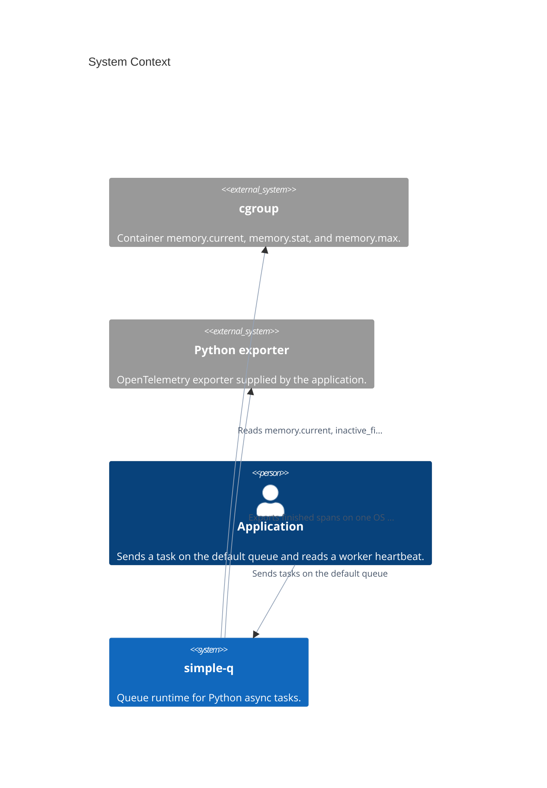

# Architecture

These pages describe simple-q 1.0.

The containers inside simple-q are **Client**, **App**, **Config**, the **worker supervisor**, and **Redis**. Client sends. App runs the handler and the dead-letter hook. Config is the only environment read. The worker supervisor forks children and watches memory. Redis holds the queue.

This is the context diagram for that model.

