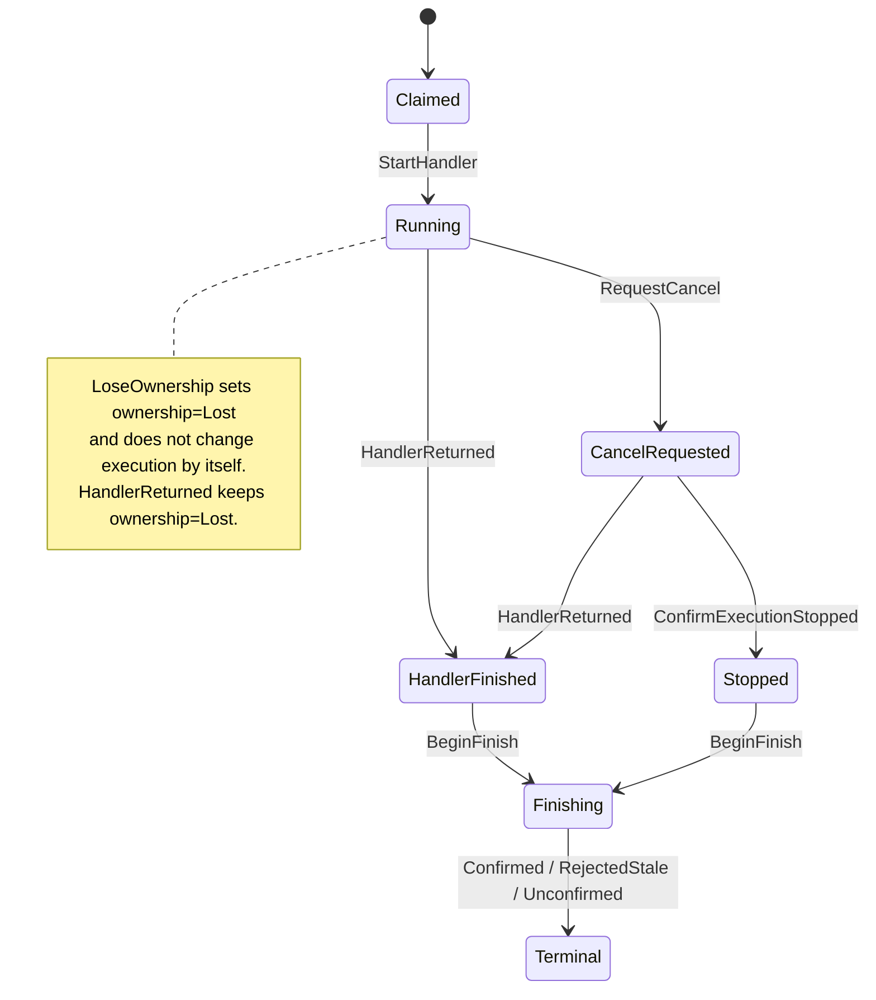
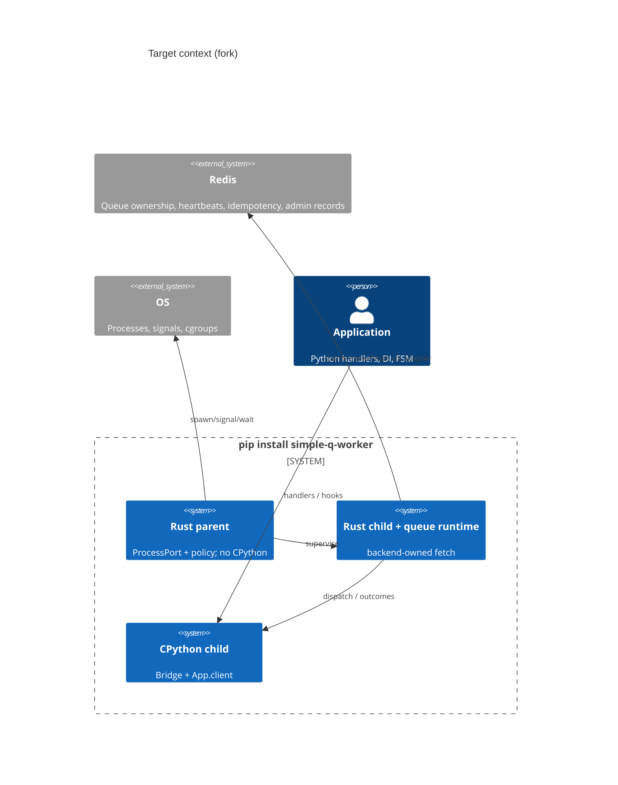

# Architecture diagrams (Stage B binding)

These diagrams are the target. The process that ships is [architecture.md](../architecture.md). The parent on main still starts CPython and still reads the Redis URL from `App.client`.

## Attempt lifecycle (axes)



## Drain barrier (admission ≠ TaskTracker.close)

```mermaid
sequenceDiagram
  participant Gate as AdmissionGate
  participant Backend as Queue adapter
  participant Tr as TaskTracker
  Note over Gate,Tr: discover shutdown
  Gate->>Gate: close admission
  Backend->>Backend: pause/stop fetch loop
  Note over Gate: settle in-flight claim race; register Attempts
  Gate->>Gate: mark_inflight_settled
  Note over Tr: close does not block spawn; it allows wait to finish when empty
  Tr->>Tr: tracker.close()
  Tr->>Tr: tracker.wait()
  Note over Gate,Tr: hooks → child exit → parent reap → escalate
```

## Target context


