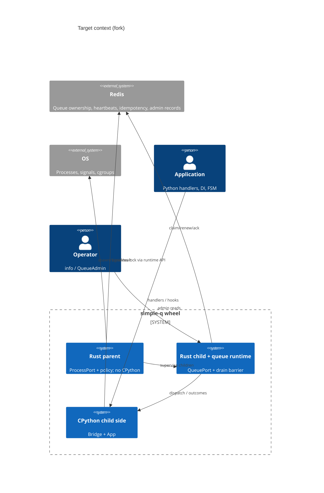
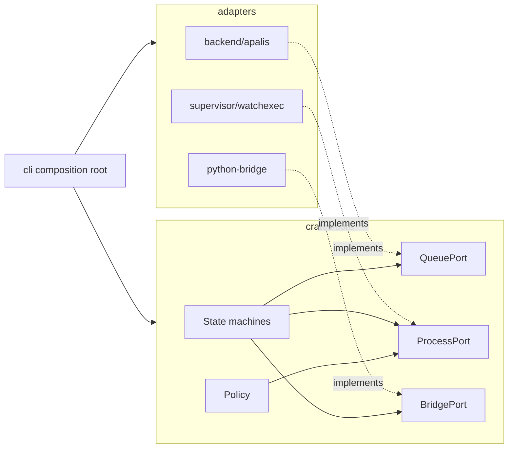
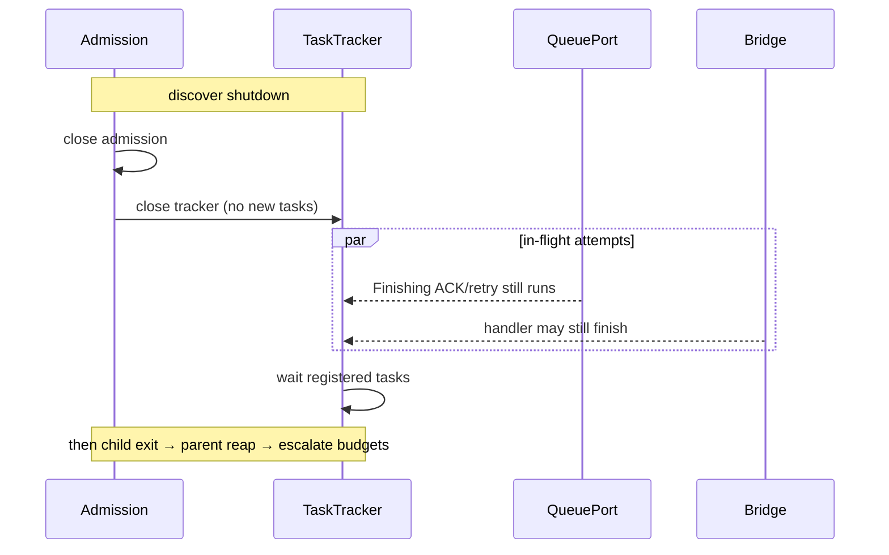
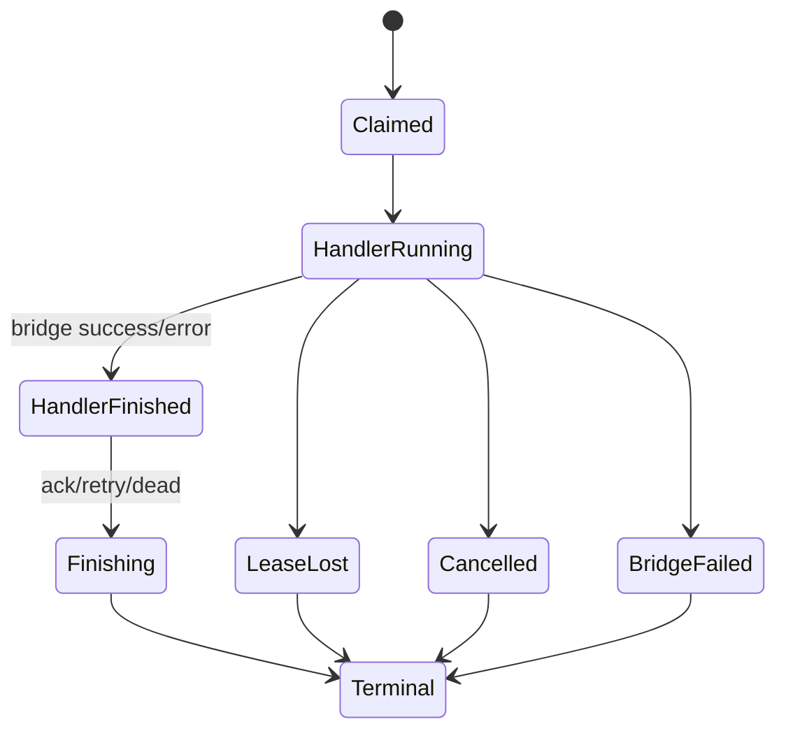

# Architecture diagrams (Stage B target)

Baseline contrast: today the parent initializes CPython to read the App; target forbids that.

## Target context

## Ports & adapters

## Drain barrier (Tokio notify → wait)

## Attempt lifecycle

